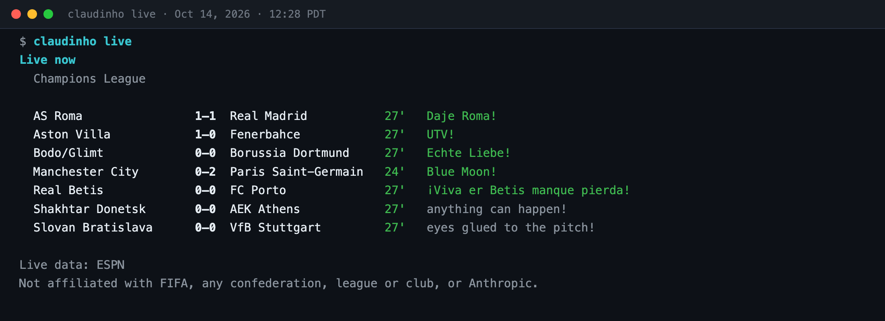
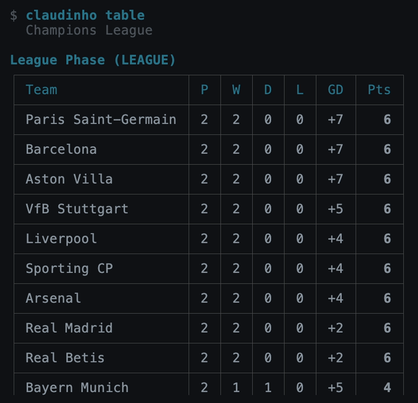
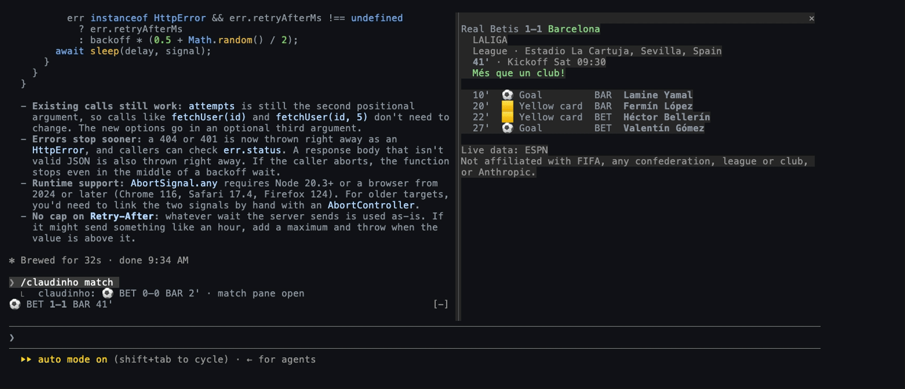
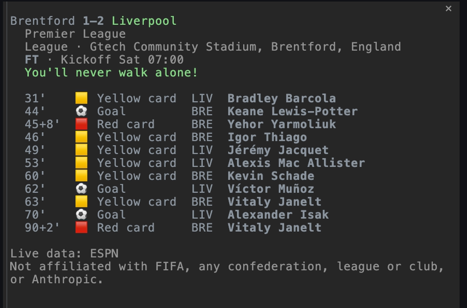
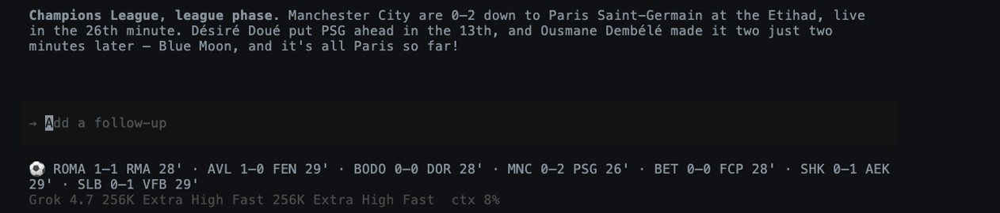
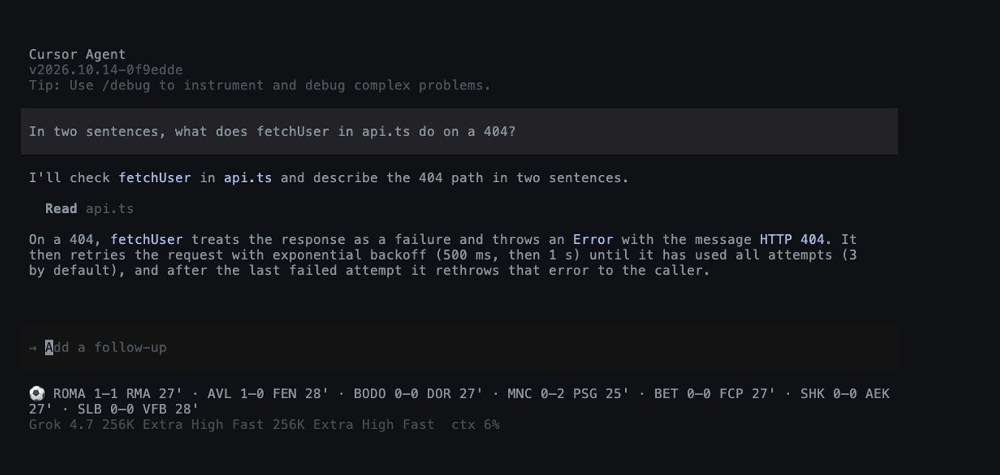

<h1 align="center">
  
</h1>

<p align="center">
  <a href="https://www.npmjs.com/package/@claudinho/cli"></a>
  <a href="https://www.npmjs.com/package/@claudinho/cli"></a>
  <a href="LICENSE"></a>
  <a href="https://github.com/arturogarrido/claudinho/actions/workflows/ci.yml"></a>
</p>

**Live football scores, fixtures and standings in your terminal and beside your coding agent, for the competition you follow: the World Cup, the Premier League, LALIGA, the Champions League and 12 more.**
Liga MX, Serie A, the Bundesliga, the Libertadores and the rest are in [the table below](#competitions).
No API key, no signup, no account.

<p align="center">
  
</p>
<!-- HERO: a real capture, `claudinho live` with the Champions League followed, during the
     Oct 14, 2026 19:00 UTC batch. Not a recording: the command's real output at that moment,
     rendered to a PNG. -->

## Try it

```bash
npx @claudinho/cli follow champions-league   # choose your competition once
npx @claudinho/cli today                     # today's matches, in your timezone
npx @claudinho/cli live                      # the matches in play right now
```

Claudinho needs Node.js 22 or later.

Your league instead? `follow premier-league`, `follow liga-mx`, `follow laliga`: every alias is in
[Competitions](#competitions). Add `--lang es` (or `pt`, `fr`) for Spanish, and pin your team with
`follow champions-league --team Arsenal`.

## Pick your setup

Start with the first row and add what you want. Every row but the MCP server needs the `claudinho`
command from the first row. The plugin replaces the Claude Code statusline and the prompt hook: use
the plugin or those two rows, not both.

| You want | What it changes | Command |
|---|---|---|
| Scores in the terminal | installs the `claudinho` command; it keeps your choice and a cache on your machine ([where](https://github.com/arturogarrido/claudinho/tree/main/packages/cli#where-it-is-saved)) | `npm i -g @claudinho/cli` |
| The live score under your Claude Code prompt | Claude Code's statusline | `claudinho init-statusline` |
| The live score above your Claude Code prompt, a toast and a celebration on a goal, and a match pane | installs a Claude Code plugin | [Claude Code plugin](#claude-code-plugin) |
| Claude Code to know the live score when you ask it something | adds a prompt hook (the plugin does this too) | `claudinho init-hook` |
| The live score in Cursor's terminal agent (Cursor CLI) | Cursor CLI's statusline | `claudinho init cursor` |
| To ask your agent about football | adds an MCP server (a set of tools your agent can call) | [MCP server](#mcp-server-any-agent) |

The statusline and the plugin's band read a local cache and never wait on the network. The
plugin's match pane is different: it runs `claudinho match <id>`, which asks the data provider.
Off-match, the prompt hook adds nothing to what the model reads.

## Competitions

Nothing is followed until you choose one. `claudinho follow <alias>` saves your choice, and the
commands, the statusline, the plugin and the MCP server follow it. Three things stay the World
Cup's whatever you follow: `claudinho team` and the MCP tool `get_team` read its nations, and the MCP
resource `fixtures://{date}` is its bundled schedule. `claudinho team` is refused when
`--competition` or `CLAUDINHO_COMPETITION` chooses another competition. `claudinho follow --list` lists
every alias with what it offers, `claudinho follow` shows your choice, and `claudinho follow off`
forgets it.

<!-- competitions:start -->
| Alias | Competition | Teams | Scores | Next | Standings | Bracket | Markets |
|---|---|---|---|---|---|---|---|
| `world-cup` | World Cup | nations | yes | yes | yes | yes | yes |
| `euro` | EURO | nations | yes | yes | yes | not yet | not yet |
| `copa-america` | Copa América | nations | yes | yes | yes | not yet | not yet |
| `nations-league` | UEFA Nations League | nations | yes | yes | yes | not yet | not yet |
| `concacaf-nations-league` | Concacaf Nations League | nations | yes | yes | yes | not yet | not yet |
| `gold-cup` | Gold Cup | nations | yes | yes | yes | not yet | not yet |
| `premier-league` | Premier League | clubs | yes | yes | yes | n/a | not yet |
| `laliga` | LALIGA | clubs | yes | yes | yes | n/a | not yet |
| `serie-a` | Serie A | clubs | yes | yes | yes | not yet | not yet |
| `bundesliga` | Bundesliga | clubs | yes | yes | yes | not yet | not yet |
| `liga-mx` | Liga MX | clubs | yes | yes | yes | not yet | not yet |
| `liga-auf` | Liga AUF Uruguaya | clubs | yes | yes | yes | not yet | not yet |
| `champions-league` | Champions League | clubs | yes | yes | yes | not yet | not yet |
| `libertadores` | Libertadores | clubs | yes | yes | yes | not yet | not yet |
| `concacaf-champions-cup` | Concacaf Champions Cup | clubs | yes | yes | n/a | not yet | not yet |
| `club-world-cup` | Club World Cup | clubs | yes | yes | yes | not yet | not yet |

`yes` offered · `not yet` not offered yet · `n/a` the competition has no such thing (a league season with no knockout tie has no bracket; a knockout-only cup has no table).
<!-- competitions:end -->

**One competition at a time.** A pinned team belongs to its competition: pinning Arsenal in the
Premier League does not follow its Champions League matches. Ask another competition for one
command with `--competition` (`claudinho --competition champions-league next Arsenal`), or set
`CLAUDINHO_COMPETITION` for a shell. Details: the
[CLI README](https://github.com/arturogarrido/claudinho/tree/main/packages/cli#choosing-a-competition).

<!-- TABLE: a real capture, `claudinho table` with the Champions League followed, on Oct 14, 2026,
     the top of the 36-club league phase, rendered to a PNG. -->
<p align="center">
  
</p>

## Install

### The terminal

```bash
npm i -g @claudinho/cli
claudinho follow champions-league --team Arsenal
claudinho today
claudinho next                 # your pinned team's next match, with a countdown
claudinho table
claudinho match <id>           # one match, with its goals and cards
```

<!-- DEMO: verbatim `claudinho --tz UTC match 401915415` (a finished Champions League match, Oct 14,
     2026), the Champions League followed with Liverpool pinned, colour off. Never hand-edit. -->
```text
LASK Linz 3–6 Liverpool
  Champions League
  League phase · Raiffeisen Arena (Linz), Linz, Austria
  FT · Kickoff Wed 16:45
  You'll never walk alone!

  22'  ⚽ Goal         LIV  Ronald Araújo
  24'  ⚽ Goal         LIV  Bradley Barcola
  37'  ⚽ Goal         LIV  Bradley Barcola
  51'  ⚽ Goal         LIV  Jeremie Frimpong
  63'  ⚽ Goal         LAS  Robert Ljubicic
  66'  ⚽ Goal         LIV  Bradley Barcola
  72'  ⚽ Goal         LIV  Lewis Koumas
  74'  ⚽ Goal         LAS  Florian Flecker
  77'  ⚽ Goal         LAS  Florian Flecker
  80'  🟨 Yellow card  LAS  Daniel Elfadli

Live data: ESPN
Not affiliated with FIFA, any confederation, league or club, or Anthropic.
```

This is a capture from Oct 14, 2026. Off the World Cup, `match <id>` finds a match from yesterday
to 14 days ahead, so run it with a current id (`claudinho today --json` lists each match's `id`).

The commands, their options and their `--json` output: the [CLI README](https://github.com/arturogarrido/claudinho/tree/main/packages/cli#readme).
To remove it: `claudinho follow off` (it deletes the saved choice), then `npm rm -g @claudinho/cli`,
then delete the cache folder (the CLI README says
[where it is](https://github.com/arturogarrido/claudinho/tree/main/packages/cli#where-it-is-saved)).

### Claude Code plugin

The plugin shows the live score (or the countdown to the next match) above your prompt, with the score in bold. A
toast says what happened (`⚽ GOAL! Liverpool · Ronald Araújo 22' · LASK Linz 0–1 Liverpool`, or
`Full time · LASK Linz 3–6 Liverpool · Liverpool win`). When your team scores, and when it wins or draws, Anthropic's
Claude mascot celebrates in the band for a few seconds. With the `toasts` option set to `all`, it also celebrates any
goal in a match that is not your team's. `/claudinho match` opens a pane with the goals and cards.
The band, the toasts, the celebration and the pane speak English, Spanish, Portuguese or French (the plugin's
`language` option). A few fixed words stay English; the plugin README lists them.

<p align="center">
  
</p>
<p align="center">
  
</p>

```bash
npm i -g @claudinho/cli
claudinho follow champions-league --team Arsenal   # the toasts and the mascot are for your pinned team by default
claudinho init plugin          # only if Claudinho's statusline or hook is in Claude Code's settings
```

`claudinho init plugin` removes, from Claude Code's settings, the statusline whose command is
`claudinho prompt` and the prompt hook whose command is `claudinho hook` (the commands `init claude`,
`init-statusline` and `init-hook` write by default), so the score does not show twice.

Then, in Claude Code in a terminal:

```
/plugin install claudinho --marketplace arturogarrido/claudinho
```

While a match is live, the plugin also puts the live score beside each prompt you send, so Claude
knows it (from its last reading, when that reading is current and recent). Off-match it adds
nothing, and the plugin's `context` option turns it off. The plugin reads everything from the
installed CLI and never fetches anything itself. Options, the desktop app and the details: the
[plugin README](https://github.com/arturogarrido/claudinho/tree/main/packages/plugin#readme).
To get new versions on their own, turn on auto-update for the `claudinho` marketplace once
(`/plugin`, the **Marketplaces** tab, **Enable auto-update**); Claude Code leaves it off by default
for this marketplace. A new version then installs after a session starts, and loads in the next
session you start or after `/reload-plugins`.
To remove it: `claude plugin uninstall claudinho@claudinho`.

**The CLI it needs.** Everything above needs `@claudinho/cli` 0.12.0 or later. With 0.11.2 the
plugin works in part: a toast is `⚽` and the hook's own English line for any score change, the
celebration is a ball and a growing "GOAL!", the band's line is plain and English, the match pane
says `Nothing to show: the CLI's answer is not one this plugin reads.`, and no full time is said. The
`language` option changes none of it. With a CLI older than 0.11.2 the band shows nothing and
nothing toasts.

### Claude Code without the plugin

```bash
npm i -g @claudinho/cli
claudinho init-statusline      # the live score under the prompt
claudinho init-hook            # optional: Claude knows the live score during a match
```

Or both at once, plus the MCP line to run: `claudinho init claude`. Each command backs up
`~/.claude/settings.json` first (to `settings.json.claudinho.bak`, once). Restart Claude Code to see
it. To remove both: `claudinho init plugin`. It removes them when their commands are still
`claudinho prompt` and `claudinho hook`, and keeps every other setting. Running a local build
instead of the global command? `init-statusline`, `init-hook` and `init-cursor-statusline` take
`--command`. From the checkout's root, after a build:
`node packages/cli/dist/index.js init-cursor-statusline --command "node \"$PWD/packages/cli/dist/index.js\" prompt"`.

### Cursor CLI

Cursor CLI is Cursor's agent in the terminal. One command puts the live score in its statusline and
prints the MCP config to paste:

```bash
npm i -g @claudinho/cli
claudinho init cursor
```

<p align="center">
  
</p>

Restart your agent session to see it. `export CLAUDINHO_CURSOR_META=auto` adds a second line with the
model and the context in use. Prefer to paste the config yourself? `claudinho init cursor --print`
prints it. To remove it: delete the `statusLine` block from `~/.cursor/cli-config.json` (the original
is kept as `cli-config.json.claudinho.bak`). Cursor's prompt hook cannot pass the score to the model
yet, so the score-aware hook is Claude Code only.

### MCP server (any agent)

The MCP server gives your agent ten read-only tools, among them today's matches, live scores, a
team's next match, standings, one match with its goals and cards, and a shareable card. It works in
Claude Code, Cursor, Codex, Claude Desktop, Windsurf, Zed, VS Code, and any MCP client that runs a
local (stdio) server.

```bash
claude mcp add claudinho -- npx -y @claudinho/mcp     # Claude Code
codex mcp add claudinho -- npx -y @claudinho/mcp      # Codex CLI
```

Most other clients, Cursor included (`~/.cursor/mcp.json`), take this config. Some (VS Code, Zed)
put the same `command` and `args` under a key of their own: see your client's MCP docs.

```json
{ "mcpServers": { "claudinho": { "command": "npx", "args": ["-y", "@claudinho/mcp"] } } }
```

Then ask mid-task. If you have not run `claudinho follow`, name the competition in your question.

<p align="center">
  
</p>

The tools, the prompts and their fields: the [MCP README](https://github.com/arturogarrido/claudinho/tree/main/packages/mcp#readme).

## What it does

- **Scores, fixtures, standings**: `today`, `live`, `next`, `table`, `match <id>` with its goals and
  cards, and `bracket` for the World Cup. Kickoff times and days are in your timezone (`--tz`).
- **Four languages**: English, Spanish, Portuguese and French (`--lang`), with a line of
  commentary on each match line (`¡GOOOOL!`) and a team's own rally cry when it has one (Mexico's
  "¿Y si sí?", Pumas' "¡Goya!", Arsenal's "COYG!"). A postponed or cancelled match gets neither.
  `--flavor off` turns it off.
- **Clubs and nations**: a nation shows with its flag, a club by its name. No crests, kits or photos.
- **Shareable cards**: `claudinho share next --copy` puts a plain-text card for the group chat on
  your clipboard.
- **Prediction-market odds**: for World Cup matches, a "who's favored" line from Polymarket's public
  data, shown under `today`, `match` and on share cards only when a reliable market exists.
  **Informational only, not betting advice.** `--no-markets` hides it there; `claudinho markets`
  asks for the odds on purpose.
- **Honest about gaps**: when the data provider sends something Claudinho cannot read, the commands
  and MCP tools that read it, and their share cards, say their data may be incomplete, instead of
  showing less as if it were all. The statusline and the hook do not.

## What stays on your machine

No accounts, no telemetry, no analytics, no Claudinho server. Claudinho asks two public services for
data, ESPN for scores and standings and Polymarket for World Cup market odds, with nothing about you
attached. The CLI keeps your choice and a small cache on your machine
([where](https://github.com/arturogarrido/claudinho/tree/main/packages/cli#where-it-is-saved)); the
MCP server writes nothing to disk. The `init` commands change only the settings file they name,
after a one-time backup. Full policy:
[PRIVACY.md](PRIVACY.md).

## FAQ

**Do I need an API key or an account?** No.

**Does it work offline?** The World Cup's schedule ships with the package, so its fixtures work
offline. Every other competition's schedule, and every live score, comes from the network.

**Where does the data come from?** Scores and standings from ESPN's public scoreboard (an answer
from it says `Live data: ESPN`), market odds from Polymarket's public data. Rate limits are respected.

**Why no crests, kits or player photos?** Claudinho shows facts and emoji flags only (and, in the
plugin's celebration, Anthropic's Claude mascot). A flag is a nation's, so a club shows by its name.

**Flags show as boxed letters (`CH`, `BA`)?** Some terminals (Warp, some Windows terminals) cannot
draw flag emoji. Claudinho detects Warp and drops the flags: the statusline and `bracket` show
3-letter codes (`MEX`), and `today`, `live`, `next`, `match`, `table`, `team` and the hook show plain
team names. Share cards keep their flags. Force it anywhere with `CLAUDINHO_FLAGS=off`, or keep the
flags with `CLAUDINHO_FLAGS=on`.

## Around the web

Coverage: [LinuxLinks](https://www.linuxlinks.com/claudinho-follow-world-cup-terminal/) and
[SuperIsland's Live Football extension](https://github.com/shobhit99/SuperIsland/tree/main/Extensions/live-football).
Listed in the
[Official MCP Registry](https://registry.modelcontextprotocol.io/v0.1/servers?search=io.github.arturogarrido/claudinho&version=latest),
[Smithery](https://smithery.ai/servers/arturogarrido/claudinho),
[Glama](https://glama.ai/mcp/servers/arturogarrido/claudinho),
[MCP.so](https://mcp.so/servers/claudinho),
[cursor.directory](https://cursor.directory/plugins/claudinho) and
[awesome-mcp-servers](https://github.com/punkpeye/awesome-mcp-servers#-sports).
The full record: [PUBLIC_FOOTPRINT.md](PUBLIC_FOOTPRINT.md).

## Why star?

Claudinho is a one-person fan project with no budget. If it earns a place in your terminal, a
[star](https://github.com/arturogarrido/claudinho) helps other developers find it and puts new
releases in your feed. Want to help build it? [CONTRIBUTING.md](CONTRIBUTING.md) has the layout, the
dev loop and good first issues.

## Security

Found a vulnerability? Please report it privately through
[GitHub's form](https://github.com/arturogarrido/claudinho/security/advisories/new), not a public
issue. [SECURITY.md](SECURITY.md) has the process and the threat model.

## License

MIT © 2026 Arturo Garrido.

Independent fan project. Not affiliated with FIFA, any confederation, league or club, or Anthropic.

_Built while watching the games._ **#VibingLaVidaLoca** ⚽
