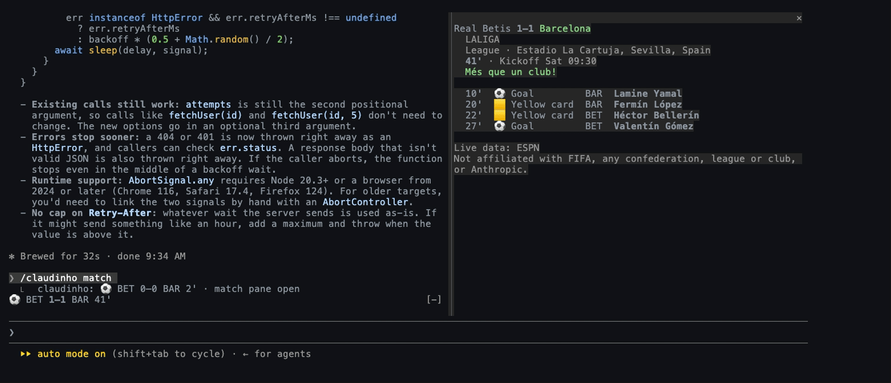
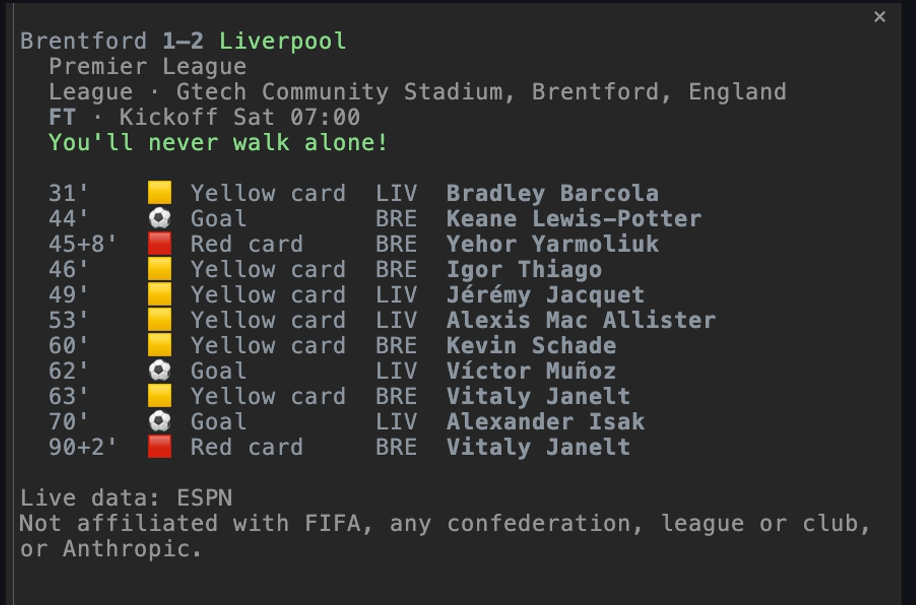

<p align="center">
  
</p>

# Claudinho for Claude Code ⚽

Live football in Claude Code, for the competition you follow:

- **The band**: the live score, or the countdown to the next match, above your prompt, the score in bold.
- **Toasts** that say what happened: a goal and its scorer, a goal against, a correction, full time and the result.
- **The celebration**: Anthropic's Claude mascot and "GOAL!" in the band, for about three seconds, when your team
  scores, and once more when it wins or draws at full time. Under `toasts: all` it also plays on any goal in a
  match that is not your team's. The mascot is Anthropic's: it is the one exception to this project's rule against
  logos and marks, and it is removed if Anthropic asks.
- **The match pane**: `/claudinho match` opens the match with its goals and cards beside the transcript.
- **The context**: while a match is live, the score goes beside the prompts you send, so Claude knows it.
- **`/claudinho`**: the band's line on demand.

<p align="center">
  
</p>
<p align="center">
  
</p>

The plugin reads everything from the `claudinho` CLI installed on your machine and never fetches anything itself.

## Install

You need the CLI (Node.js 22 or later) and a competition to follow. Node.js 22 is the oldest line it
runs on, not a security level: run a patched release of the Node 22 or 24 line. Everything on this page
needs `@claudinho/cli` 0.12.0 or later ([Which CLI it needs](#which-cli-it-needs)). Installed before the CLI, or
beside one too old, the plugin says so once per session in a toast, with the command to run.

```bash
npm i -g @claudinho/cli
claudinho follow premier-league --team Arsenal   # the toasts and the celebration are for your pinned team by default
claudinho init plugin          # only if Claudinho's statusline or hook is in Claude Code's settings (see below)
```

Then, at the prompt of Claude Code **in a terminal**:

```
/plugin install claudinho --marketplace arturogarrido/claudinho
```

Answer `y` to add the marketplace, then choose a scope (the user scope is the first, press Enter).
The plugin is active in that session from then on. Installed at the user scope from a terminal, it
also loads in the desktop app's Code tab, which cannot run `/plugin install` itself.

`claudinho init plugin` removes, from `~/.claude/settings.json`, the statusline whose command is
`claudinho prompt` and the prompt hook whose command is `claudinho hook` (the commands `init claude`,
`init-statusline` and `init-hook` write by default), so the score does not show twice. It keeps every
other setting. Any other command stays (a wrapper, an `npx` form, a `--command` one), and
`init plugin` names it when it mentions `claudinho`.

**To get new versions on their own:** Claude Code leaves auto-update off by default for this
marketplace. Turn it on once: run `/plugin` in a terminal, open the **Marketplaces** tab, select
`claudinho` and choose **Enable auto-update**. A new version then installs in the background after a
session starts; the session you are in keeps the version it loaded until you run `/reload-plugins`,
and the next session you start loads the new one.

**To remove the plugin:** `claude plugin uninstall claudinho@claudinho`.

## Options

Change them in `/config`.

| Option | Values | Default |
|---|---|---|
| `toasts` | `pinned`: your pinned team's match; `all`: every live match of the competition you follow; `off`: none | `pinned` (with no team pinned: the session's first goal, then one hint on how to pin, then none) |
| `celebrate` | `on`: the celebration plays on your team's goal and on its win or draw, and under `toasts: all` on any goal in a match that is not your team's; `off`: it never plays. The toasts are the same either way | `on` |
| `context` | `on`: while a match is live, the score goes beside each prompt you send, for Claude; `off`: nothing goes with your prompts | `on` |
| `language` | `auto`: the language your environment asks for (below); `en`, `es`, `pt` or `fr`: that language, whatever the environment says | `auto` |

Changing an option reloads the plugin. The band and every later toast follow the new value at once.
An open match pane stays as it was drawn and stops reading: run `/claudinho match` again to update it.

## What you see

**The band** shows the line `claudinho prompt` prints, in the plugin's language: the live score
(`⚽ ARS 2–1 CHE 50'`, the score in bold), or the countdown to the next match (`⚽ ARS vs LEE in 7h13m`). From
kickoff until the data provider marks the match live, for up to 30 minutes, the countdown reads the
language's word for now (`⚽ BET vs BAR now`; `ahora`, `agora`, `maintenant`) and keeps that match.
With several matches live it shows them side by side (up to eight, and a count of the rest), or,
while your pinned team is playing, its match and a count of the others (`+2`). It shows nothing
when no competition is followed or nothing is known. At the end of the World Cup it shows its sign-off line.

**A toast** is one line: what happened, then the score. Examples with Liverpool pinned, away at LASK Linz:

| What happened | The toast |
|---|---|
| Your team scores | `⚽ GOAL! Liverpool · Ronald Araújo 22' · LASK Linz 0–1 Liverpool` |
| ... and the scorer is not yet known | `⚽ GOAL! Liverpool 60' · LASK Linz 0–1 Liverpool` |
| An own goal for your team | `⚽ Own goal · Liverpool 63' · LASK Linz 1–2 Liverpool` |
| A goal against your team | `Goal for LASK Linz · Robert Ljubicic 63' · LASK Linz 1–1 Liverpool` |
| More than one goal since the last reading | `Goals · LASK Linz 1–2 Liverpool` |
| A score corrected down | `Score updated · LASK Linz 0–0 Liverpool` |
| A penalty shootout goes on | `Penalties · LASK Linz 1(3)–1(4) Liverpool` |
| Full time | `Full time · LASK Linz 3–6 Liverpool · Liverpool win` (or `· Draw`) |

The scorer is named only when the CLI proves it: its listed goals add up to the score, and the newest one is on the
side that scored. Toasts are best effort, not a promise of every goal: a goal the plugin could not confirm when it
happened is said late, at the first reliable reading after it.

**The celebration** plays on your team's goal (under `toasts: all`, on any goal in a match that is not your
team's): the mascot on the left in your theme's Claude colour, its legs
stepping, the ball crossing the top row, `GOAL! Liverpool` with `GOAL!` bold and in your theme's success colour, and
the scorer's row under it. After about three seconds the band is one line again. At full time, on your team's win or
draw (your team's match only), the mascot plays once more for five seconds beside `Full time · Liverpool win`. A goal against, a
correction, penalties and a loss play nothing. While Claude is working the celebration waits, and plays when the turn
ends (within a minute; after that the toast has already said it).

**The match pane** opens with `/claudinho match` and shows the match you follow now: the score in bold, your team in
the success colour, the competition, stage and venue dimmed, the status and the kickoff, and the goals and cards, each
marked (`⚽`, `🟨`, `🟥`) with the scorer in bold. In a narrow pane the player of each goal or card goes on the next
line, under the event. It updates when the band sees the score change, and every two
minutes while the match is in play. Close it with its close mark (or ctrl+x x). The command answers in one line,
`claudinho: ⚽ LAS 0–4 LIV 62' · match pane open`, when the pane opened.

**The context**: while a match is live, each prompt you send carries the live score for Claude,
from the plugin's last reading, when that reading is current and less than 30 seconds old.
Off-match it adds nothing. The `context` option turns it off.

**`/claudinho`** prints the band's line now, with the data provider's name and the non-affiliation
sentence under it, or one plain sentence when there is nothing to show.

## Where it works

- **Claude Code in a terminal, and the desktop app's Code tab.** The band, the toasts, the
  celebration and the pane draw there.
- **Without a window** (`claude -p`, the SDK, a phone, an editor alone) the band runs nothing.
  `/claudinho` still answers when you type it.
- **The match pane** docks beside the transcript in the fullscreen layout from 110 columns, and sits
  above the prompt in a narrower terminal. In the desktop app it opens as a side panel.

## Which CLI it needs

`@claudinho/cli` 0.12.0 or later, the newest for everything on this page. With no CLI on the `PATH` the plugin runs,
a toast says `To see scores, install the CLI: npm i -g @claudinho/cli`, once per session. With CLI 0.11.2, it says
`This plugin needs a newer CLI: npm i -g @claudinho/cli@latest`, and still shows the band and toasts a score change in
the CLI's own English line. `/claudinho` answers the same sentence each time you ask. A CLI older than 0.11.2 has no
`ambient` command: the band stays empty and `/claudinho` answers `The CLI gave no answer.` A newer CLI states the
number of the contract it prints (`api`; not a version), and the plugin compares it with the lowest it reads.

A CLI before 0.14.0 does not say when the band's line is `live · syncing…`. With one, the plugin checks every minute,
not every five, on a countdown more than an hour out whose reading is not current (the sign-off and the "no
competition followed" line keep five minutes): up to 60 runs an hour off-match
(240 before this plugin version), and 12 an hour once the CLI is 0.14.0 or later.

## Details

### Finding the CLI

The plugin runs `claudinho` from the `PATH` Claude Code started with. When that `PATH` does not hold
it (an app can start Claude Code with a minimal `PATH`), the plugin also looks where the usual
installers put global commands: nvm's recent Node versions, `~/.volta/bin`, `~/.local/share/pnpm`,
`~/Library/pnpm`, `~/.bun/bin`, `~/.npm-global/bin`, `~/.local/bin`, `/opt/homebrew/bin`,
`/usr/local/bin`, `/usr/bin` and `/bin`. When a run cannot start and none of those folders holds `claudinho`,
a toast says once per session `To see scores, install the CLI: npm i -g @claudinho/cli`, and `/claudinho` answers
the same. A CLI that is there but took too long or failed gets `The CLI gave no answer.` On Windows the plugin uses
Claude Code's own `PATH` only, and never says the CLI is missing.

### The language

`auto` speaks the language your environment asks for, as the CLI reads it: `CLAUDINHO_LANG`, then the language part
of `LANG` (`es_MX.UTF-8` is Spanish), each only when it is `en`, `es`, `pt` or `fr`, else English. The band, the
toasts, the celebration and the match pane follow the option. A Spanish session reads
`⚽ ¡GOL! Liverpool · Ronald Araújo 22' · LASK Linz 0–1 Liverpool` and `⚽ BOU vs BRE en 17m`. The words come from the
CLI: the plugin passes `--lang` with the chosen code to the CLI runs of the band and of `/claudinho`, and to the match
pane's runs once the CLI has said it speaks that language. Names, scores and minutes are never translated.

Some things stay English in every language: the terminal statusline (`claudinho prompt`), the hook, the live score
beside your prompt for Claude, the band's `+more`, the World Cup's sign-off line and `⚽ —`. The countdown's units
(`2d4h`, `17m`) are the same in every language. An open match pane keeps its rows in the language it read them in
until `/claudinho match` opens it again.

### How the band reads

The band runs `claudinho ambient --json` at a pace set by what the last run said, which also keeps the CLI's local
cache fresh:

| The last run said | The next run |
|---|---|
| A match live, the line `live · syncing…`, or a match that finished in the last ten minutes | 15 seconds |
| The next kickoff 2 minutes away or less, or passed and not live yet | 15 seconds |
| The next kickoff within the hour | every minute, then 15 seconds from 2 minutes before |
| The next kickoff more than an hour away | every 5 minutes, then every minute from an hour before |
| Nothing known, or no answer (no CLI, a timeout) | every minute |
| No competition followed, or the World Cup's sign-off | every 5 minutes |

The next fixture is your pinned team's when it has one: with your team's match days away, another match of the
competition reaches the band up to five minutes after it kicks off. A goal in that gap may go unsaid: the first
reading of a match says nothing (see [When a toast is raised](#when-a-toast-is-raised)).
That command answers from the cache and never waits on the network; when the cache is due for a
refresh it starts the CLI's background refresh, as the statusline does. While no competition is
followed it reads no cache and starts nothing: its line is `⚽ claudinho follow`. The CLI fits the line to the band's width and marks
each score in it; the band draws the marks only when they spell the line exactly. A band another plugin draws
beneath ours stays, under our line.

### When a toast is raised

A toast compares two readings the CLI vouches for: not stale, not degraded, and from a complete read.
The first reading of a match says nothing, and neither does a change of competition. When one change could read two
ways, the first that holds is said: `Score updated`, then `Penalties`, then the goal, then `Goals`. Every toast
follows the `toasts` option.

**With no team pinned** (and no `CLAUDINHO_TEAM`), `toasts: pinned` says the session's first goal in a live match whose
reading names its teams (CLI 0.12.0 or later) as `all` would, with its celebration, then one toast for ten seconds:
`Pin your team to get only its goals: claudinho follow <alias> --team <name>`, with the competition you follow. A
correction, a shootout update or two goals between readings is not that first goal, and is not said. After it, no
toast and no celebration until you pin a team (the next reading follows the pin); the band's score still changes, in
bold.

**Full time is said only by a current reading.** The CLI lists a finished match for ten minutes after the reading that
saw it end, and stops polling once the day's last match is over, so a session with no current reading in the minutes
after the whistle (closed, idle or offline then) hears nothing about it.

### What stops a celebration

The celebration takes up to three rows above the line and leaves room for a band beneath ours. With two rows it shows
`GOAL! Liverpool` and the scorer's row, with one `GOAL! Liverpool 22'`, and with none it waits. A later score change
in that match, a change of the competition you follow, the last window closing, a reload of the plugin (changing an
option reloads it) or, while it waits, the minute running out drops it. A full-time celebration lasts only while
each later reading still lists the match as finished with the same result: another result at the same score, the
match listed live again, or not listed at all drops it (a goal celebration queued before it keeps its own rules).

### `/claudinho` replies

When there is nothing to show, `/claudinho` answers one of these sentences, chosen from what the CLI
answered:

- `To see scores, install the CLI: npm i -g @claudinho/cli` The CLI could not be started, and none of the folders
  the plugin runs it from holds it.
- `This plugin needs a newer CLI: npm i -g @claudinho/cli@latest` The CLI answered in a form older than 0.12.0.
- `The CLI gave no answer.` The CLI is there but took longer than two seconds, failed, or printed something that is
  not its answer.
- `No competition followed yet.` Run `claudinho follow <alias>`.
- `Nothing to show: the CLI's answer is not one this plugin reads.` The CLI was set to a competition it does not
  know (`CLAUDINHO_COMPETITION`), or failed while answering.
- `Nothing to show right now: no live match and no next fixture known.`
- `The edition you follow is over.`

A reply made from a reading ends with the provider's name and the non-affiliation sentence, each when the reading
carries it. `/claudinho match` answers in one line only when its pane opened on a terminal or desktop window and
holds both of those sentences; otherwise it gives the same reply as `/claudinho`. Each `/claudinho` runs the CLI once
and changes nothing the band shows. A `/claudinho` typed while Claude is working runs when the turn ends.

### The match pane, in full

- **Which match.** The first live match (your pinned team's comes first), else the next fixture, in
  the competition you follow when you open it. A match whose kickoff passed less than 30 minutes ago and that the data
  provider still lists as scheduled counts as the next fixture, so the pane opens on today's match. The pane stays on
  that match. If you follow another competition while it is open, the pane keeps reading its own with
  `--competition`, so its row then says "from the command line".
- **When it reads.** It opens at once with the band's line and fills in when the CLI answers (a few
  seconds on a slow network). It reads again when the band sees the score change, at kickoff, at full
  time, and every two minutes while the match is in play. Before kickoff it waits for the kickoff.
  After a final result it stops. It never runs two reads at once. After the plugin reloads (changing
  an option reloads it) the pane stays as it was drawn and reads again only from the next
  `/claudinho match`.
- **The styles.** The CLI sends each row as styled parts beside its plain text; the pane draws the styles only when
  the parts spell the plain rows exactly, else the plain rows.
- **Long rows.** The pane never cuts a row sideways. When a goal or card row with its player is wider than the pane,
  every such row of the match puts the player on the next line, under the event (`Goal`, `Yellow card`), so the
  timeline reads as one column. Any other row too wide for the pane continues under its own first character (an
  indented row keeps its indent). The pane measures widths as the CLI does.
- **When a read fails.** On opening: `The CLI gave no answer.` Later: the last rows stay, under
  `Could not refresh: showing the last reading.`
- **What it costs.** Each read is one `claudinho match <id>`, which asks the data provider about five
  times. In play that is about two and a half requests a minute, plus one read per goal. Before
  kickoff and after full time, none. When the provider asks the CLI to slow down, the pane's reads
  wait too.

## What the plugin runs, reads and sends

Everything the plugin's code (`hooks/register.tsx`) does beyond drawing the band, the toasts and the pane is listed
here.

### The program it runs

The plugin runs one program, `claudinho`: the CLI you installed. It runs it in these forms and no other:

| When | The command |
|---|---|
| The band, every 15 seconds to every 5 minutes while a terminal or desktop window is attached (see [How the band reads](#how-the-band-reads)) | `claudinho ambient --json --columns <N> --lang <xx>` |
| `/claudinho` and `/claudinho match`, when you type them | `claudinho ambient --json --lang <xx>` |
| The match pane, after `/claudinho match` | `claudinho match <id> --json`, then `--competition <slug>` and `--lang <xx>` when they apply |

Four arguments are not fixed text. Each comes from one place:

- `<N>`: the band's width in columns, as Claude Code reports it (80 until it does).
- `<xx>`: `en`, `es`, `pt` or `fr`. The `language` option decides it; under `auto`, `CLAUDINHO_LANG` or `LANG` does
  (see [The language](#the-language)). The pane's runs add it once the CLI has said it speaks that language.
- `<id>`: the id of the match the CLI's own last answer listed (the live match or the next fixture).
- `<slug>`: the competition the CLI's own answer named when the pane opened. The pane adds it once a run made
  without it answers for another competition or for none (you followed another one after opening the pane).

None of them comes from your prompts, your files or the conversation. The plugin passes the arguments as a list, with
no shell, and writes nothing to the program's input. A band or `/claudinho` run may take 2 seconds, a pane run 5;
Claude Code stops a run that takes longer. Off Windows, the plugin hands the run one variable, `PATH`, made of the
folders in Claude Code's own `PATH` and folders from [Finding the CLI](#finding-the-cli). Every other variable of
Claude Code's environment reaches the run as it is. On Windows the plugin hands nothing, and the run gets Claude
Code's environment as it is.

Why a program: the CLI owns the football data. It reads ESPN, keeps the local cache and respects the provider's
limits. The plugin itself makes no network request. What leaves your machine is the CLI's own requests to ESPN (and
to Polymarket for a World Cup match's market signal in the pane), as [PRIVACY.md](https://github.com/arturogarrido/claudinho/blob/main/PRIVACY.md)
describes. Those requests carry football parameters, such as a competition and dates, never anything from your
session.

### What it reads on your machine

- **Environment variables:** `OS`. Off Windows, also `PATH` and `HOME`. Under `language: auto`, also
  `CLAUDINHO_LANG` and `LANG`.
- **Folders:** off Windows, with `HOME` set to an absolute path, it lists `~/.nvm/versions/node` (its first 256
  entries) and checks up to eight of the newest version folders for `bin/claudinho`, once per plugin load. That
  finds a CLI nvm installed when Claude Code started with a bare `PATH`. When a run of the CLI cannot start, it
  checks each folder of the `PATH` it handed that run for `claudinho` (once per session for the band, and at each
  `/claudinho` that fails), to say whether the CLI is installed. It reads no file's contents and writes no file.
- **The session:** which windows are attached. Without one the band runs nothing; `/claudinho` still runs the CLI
  when you type it.

### Your prompts and your commands

- **Each prompt you send** (the `prompt.submit` hook): with `context: on`, when the plugin's last reading is current,
  still inside the CLI's own deadline for it, less than 30 seconds old and shows a live match, the hook adds the
  CLI's short note beside your prompt, as the CLI wrote it: the line `[Claudinho — live football scores right now]`
  and one line per live match, the team you picked first (at most 12, then a line when more are not shown; the CLI
  cuts a longer note at about 4,096 characters and says so). Claude Code sends that note to the model with your
  prompt. The hook does not read your prompt's text, change it, keep it or send it anywhere, and it starts no
  program. With `context: off` it adds nothing.
- **`/claudinho`** (the `command.run` hook): the hook answers the command the plugin registers, `/claudinho`, and no
  other. It reads the text you typed after `/claudinho` for the word `match` alone. It runs the CLI as listed above,
  answers with text (the band's line, or a sentence when there is nothing to show), and opens the pane for `match`.
- **Its other hooks** (a session starting, a window attaching or leaving, a turn starting or ending, the band and the
  pane drawing, the pane closing) pace the band's runs, hold the celebration while Claude works, and draw what the
  CLI answered. They read and send nothing beyond what this section lists.

## Data and disclaimer

Live data: ESPN, read by the CLI, which keeps it in a local cache. The plugin's football data is the
CLI's answer alone. The plugin itself makes no network request and writes no file. Full policy:
[PRIVACY.md](https://github.com/arturogarrido/claudinho/blob/main/PRIVACY.md).

Independent fan project. Not affiliated with FIFA, any confederation, league or club, or Anthropic.
